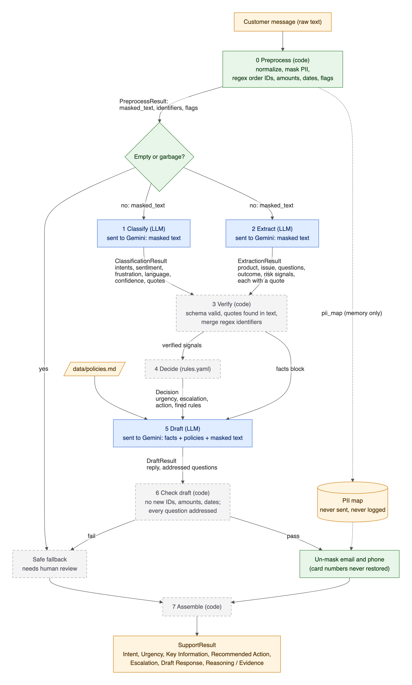

# Customer Support Intelligence

Takes one raw customer support message and returns a structured triage result for the support team:
intent, urgency, key information, recommended action, escalation, a draft reply, and the evidence behind every decision.

> Status: **Milestone 2 of 8** (LLM steps with V1 prompts + CLI). See [Progress](#progress).

## Problem statement and our understanding

A company receives hundreds of support messages a day. One message can mix a problem, product details, several questions,
urgency, frustration and requests for refunds or escalation. Agents lose time reading, triaging and drafting replies.

Our understanding of what "good" means:
- **Never miss an escalation** (legal threat, safety issue, angry repeat customer). A missed escalation is worse than an extra one.
- **Never invent facts**: no made-up order numbers, refund amounts, timelines or policies in the reply.
- **Every decision is explainable**: each output comes with the quote, signal or rule that produced it.
- **Say "I'm not sure"**: vague, spam, sarcastic, non-English or manipulative messages are flagged for a human instead of guessed.

## Solution overview

A chain of small steps instead of one big prompt. LLM (Google Gemini) only where language understanding is needed;
code and rules everywhere else.

| # | Step | Type |
|---|---|---|
| 0 | Preprocess: normalize, garbage check, PII masking, regex IDs/amounts/dates, injection flag | Code |
| 1 | Classify: intents, sentiment, frustration, language, confidence | LLM |
| 2 | Extract: product, issue, questions, requested outcome, risk signals (all with quotes) | LLM |
| 3 | Verify: schema validation, retry, quote-exists check | Code |
| 4 | Decide: urgency, escalation, action | Rules (`src/rules.yaml`) |
| 5 | Draft reply | LLM |
| 6 | Check draft for invented facts | Code |
| 7 | Assemble final output | Code |



Full design and reasoning: [docs/architecture.md](docs/architecture.md) · Technical spec: [Markdown](docs/technical_specification.md) / [PDF](docs/pdf/technical_specification.pdf).

## How to run

```bash
python3 -m venv .venv && source .venv/bin/activate
pip install -r requirements.txt
cp .env.example .env          # then set GEMINI_API_KEY (https://aistudio.google.com/apikey)

pytest                        # unit tests (no API key needed, no quota used)

python -m src.cli "My order #45821 never arrived, I want a refund"   # run one message, see every step
python -m src.cli --json "..."                                         # full result as JSON
streamlit run app.py                                                   # demo UI at http://localhost:8501
python scripts/build_docs.py                                           # rebuild diagrams + spec PDF (needs Chrome)
```

| Env var | Meaning |
|---|---|
| `GEMINI_API_KEY` | Google AI Studio API key. Never commit it. |
| `GEMINI_MODEL` | Model used by every LLM step (default `gemini-3.5-flash`). |
| `GEMINI_THINKING_LEVEL` | `minimal` / `low` / `medium` / `high` (default `low`). |
| `LLM_TEMPERATURE` | Empty = model default. |
| `PROMPT_CLASSIFY`, `PROMPT_EXTRACT`, `PROMPT_DRAFT` | Prompt version per step, e.g. `v1` → `prompts/classify_v1.md`. |

> Free-tier Gemini keys allow ~20 requests per model per day; one message uses 3.

*(Evaluation commands are added in Milestone 5.)*

## Team members
<TEAM MEMBER NAMES>

## Live URL
not deployed

## Documentation
| Doc | Contents |
|---|---|
| [docs/technical_specification.md](docs/technical_specification.md) ([PDF](docs/pdf/technical_specification.pdf)) | Technical spec: stack, components, data contracts, LLM integration, config, security, testing |
| [docs/diagrams/](docs/diagrams/) | [Architecture](docs/diagrams/architecture.png) and [data flow](docs/diagrams/data_flow.png) diagrams (PNG, SVG, Mermaid source) |
| [docs/architecture.md](docs/architecture.md) | Design, decomposition, LLM vs rules, decisions, trade-offs, diagram |
| [docs/prompt_engineering.md](docs/prompt_engineering.md) | V1 → result → problem → improvement → V2 → final, per prompt |
| [docs/evaluation.md](docs/evaluation.md) | Metrics, results tables, analysis |
| [docs/failure_cases.md](docs/failure_cases.md) | Failure cases: what went wrong, why, what we changed |
| [docs/ai_usage.md](docs/ai_usage.md) | How AI tools were used |
| [docs/demo/](docs/demo/) | Screenshots / demo video |
| [prompts/](prompts/) | Every prompt version (v1, v2, final) |
| [src/](src/) | Pipeline modules |
| [data/](data/) | Test cases and mock policies |
| [eval/](eval/) · [notebooks/](notebooks/) | Evaluation runner and notebook |
| [tests/](tests/) | Unit tests |

## Progress
- [x] 1. Schemas + preprocessing (+ tests)
- [x] 2. LLM client + Classify / Extract / Draft with V1 prompts
- [ ] 3. Rules engine (`rules.yaml`)
- [ ] 4. Validation, retry, hallucination checks, fallback
- [ ] 5. Labeled test set + evaluation runner (V1 baseline)
- [ ] 6. Prompt iterations
- [ ] 7. Streamlit app
- [ ] 8. Final docs pass
