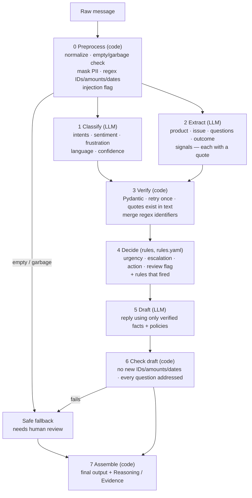

# Architecture

> Status: living document, updated after every milestone. Sections marked *(planned)* are not built yet.

## 1. Problem decomposition

One raw customer message is turned into a structured triage result through a **chain of small steps**.
Each step has one job, a typed input/output (`src/schemas.py`), and is either **code/rules** or an **LLM call**.
We use an LLM only where the task needs language understanding; everything with an exact answer is code.

Steps 1 and 2 don't depend on each other, so they run **in parallel**: 3 LLM calls per message, 2 of them concurrent.

## 2. LLM vs. code: why each step is what it is

| Step | Type | Why |
|---|---|---|
| 0 Preprocess | Code | Empty checks, Luhn-validated card numbers, order-ID/amount/date patterns all have exact answers. Regex is free, instant, deterministic and testable; an LLM can mis-copy an ID. |
| 1 Classify | LLM | Intent, sarcasm, frustration and language need language understanding; keyword rules fail on "great, *another* broken charger". |
| 2 Extract | LLM | Product, the customer's actual questions and requested outcome are phrased freely. Every value must come with a verbatim quote so code can verify it. |
| 3 Verify | Code | Checking that a quote is a substring of the message is exact; asking an LLM "did you hallucinate?" is not. |
| 4 Decide | Rules | Urgency, escalation and the action are business decisions: they must be predictable, auditable and changeable by non-engineers. The LLM only supplies *signals*; rules decide. This is also our main prompt-injection defence: no LLM output can trigger a refund or escalation directly. |
| 5 Draft | LLM | Writing a polite, empathetic, specific reply is what LLMs are good at. It is constrained to verified facts + `data/policies.md`. |
| 6 Check draft | Code | "Does the draft contain an order ID / amount / date that was not in the input?" is a regex comparison. |
| 7 Assemble | Code | Pure formatting. |

## 3. Design decisions (log)

### Milestone 1: schemas + preprocessing

| Decision | Alternatives considered | Why we chose it |
|---|---|---|
| **Gemini** (`google-genai` SDK), model name from `GEMINI_MODEL` env | Claude (original brief) | Team decision. The model name lives in config so the evaluation can compare models without code changes. |
| **Pydantic models are the contract** between steps | Plain dicts | Validation errors are precise (good for the retry prompt), and the same models generate the JSON schema sent to Gemini. |
| **Enums** for intent, frustration, urgency, signals | Free-text labels, 0–1 float for frustration | Rules can match enums exactly. Ordered levels (none/low/medium/high) are applied more consistently by an LLM than a float. |
| Separate **`spam_off_topic`** and **`unclear`** intents | One "other" bucket | They need different handling: spam → no reply / close; unclear → ask a clarifying question. |
| **Mask PII with placeholders** (`[EMAIL_1]`) rather than deleting | Delete, or send PII to the LLM | The LLM never sees card numbers/emails/phones, but sentences stay readable and we can un-mask the draft afterwards. `pii_map` is excluded from serialization so it can't leak into logs or eval files. |
| **Luhn check** before masking a long number as a card | Mask every 13–19-digit number | Many order/tracking numbers are long digit strings; masking them would break extraction. Trade-off: ~10% of random 16-digit IDs pass Luhn by chance and get masked. |
| Order IDs, amounts, dates are **not masked** | Mask everything | They are not personal data and the LLM needs them for context. |
| **Identifiers extracted after masking** | Before | A phone number can't then be mistaken for an order ID. |
| **Narrow phone patterns** (international `+`, US `(xxx) xxx-xxxx`, Indian 10-digit mobile) | One broad digit-run regex | A broad regex masks order IDs, which breaks the pipeline; a missed phone is a smaller harm (the LLM still never acts on it). Known gap: a 10-digit order ID starting with 6–9 *without* the word "order" is masked as a phone. |
| **Don't reject non-English** text; only reject empty/garbage | Language-detect and reject | Language detectors are unreliable on short texts, and mixed-language messages are legitimate. The classifier reports the language; rules route non-English to review. Garbage detection counts Unicode letters **and combining marks**, so Hindi/Devanagari text isn't misread as symbols. |
| A message with **no letters but an identifier** (e.g. `#45821`) is "very short", not garbage | Treat as garbage | Customers do reply with just an order number. |
| **Injection = flag, not block** | Block the message | The phrase "ignore the instructions in the manual" is legitimate; real defence is structural (rules decide actions, message is wrapped as data). The flag routes the case to human review. |
| Truncate input at **5,000 chars** (flagged) | No limit | Bounds cost/latency; real support messages are far shorter. |

### Milestone 2: LLM steps (V1 prompts) + CLI

| Decision | Alternatives considered | Why we chose it |
|---|---|---|
| **Structured output** (`response_json_schema` generated from the Pydantic models) | "Return JSON only" in the prompt | The format is enforced by the API, so prompts can focus on meaning. We still validate, because constrained output can still violate value rules (e.g. confidence range). |
| **Retry once with the validation error** shown to the model (multi-turn: its own output + the error) | No retry / retry blindly | A precise error ("primary_intent: 'refunds' is not a valid enum member") lets the model fix its own output. One retry bounds cost. |
| **Don't retry 429 (quota) errors; retry 5xx once**; SDK auto-retries turned off | SDK default retries | On the free tier a 429 means the daily quota is gone. In our first test the SDK silently retried for 3+ minutes. Fail fast and visibly instead. |
| **Errors are returned, not raised** (`LLMResponse.error`) | Exceptions | The pipeline must always produce *some* result; a failed step leads to the "needs human review" fallback (Milestone 4). |
| **Pinned model `gemini-3.5-flash`** | `gemini-flash-latest` | A "-latest" alias can change between eval runs, and it shared a quota that was already exhausted. |
| **Thinking level `low`** (configurable) | Model default | Triage doesn't need deep reasoning; low thinking keeps latency (~2.5 s per call) and billed output tokens down. To be compared in the evaluation. |
| **Temperature left at the model default** (configurable) | Temperature 0 | Google recommends the default for Gemini 3 models. We'll *measure* consistency (3 runs per case) instead of assuming. |
| **Prompts in versioned files** `prompts/<step>_<version>.md`, version chosen by env var | Inline strings | Every version is kept and diffable, and the evaluation can compare versions without code changes. |
| `{{placeholder}}` filling in **one pass** | `str.format` / sequential replace | Prompts contain JSON braces and `$`; a single pass means a customer typing `{{policies}}` can't pull other prompt content into their message. |
| **Classify and Extract run in parallel** (2 threads) | Sequential | Neither needs the other's output. Wall-clock time is reported separately from per-step time. |
| **Draft gets a `facts` block** built in code + `data/policies.md` + the message | Just the message | The draft may only use verified facts and written policies, so code can later check it invented nothing. Step-0 flags (card number shared, injection) become explicit notes for the writer. |
| **Un-mask email/phone in the final draft; never card numbers** | Leave placeholders | The agent needs a readable reply; card numbers must never be echoed back. |
| **Mock policies in ₹ / India conventions** | $ | Matches the team's context. Regex amounts support both. |

## 4. Trade-offs and known limitations

- **Free-tier quota: 20 requests per model per day, 3 requests per message.** That's ~6 messages/day/model, so a full
  evaluation (≥25 cases × 3 runs) needs either a paid key or several days. Unit tests use a fake client and need no quota.

*(Filled in as we evaluate.)*
