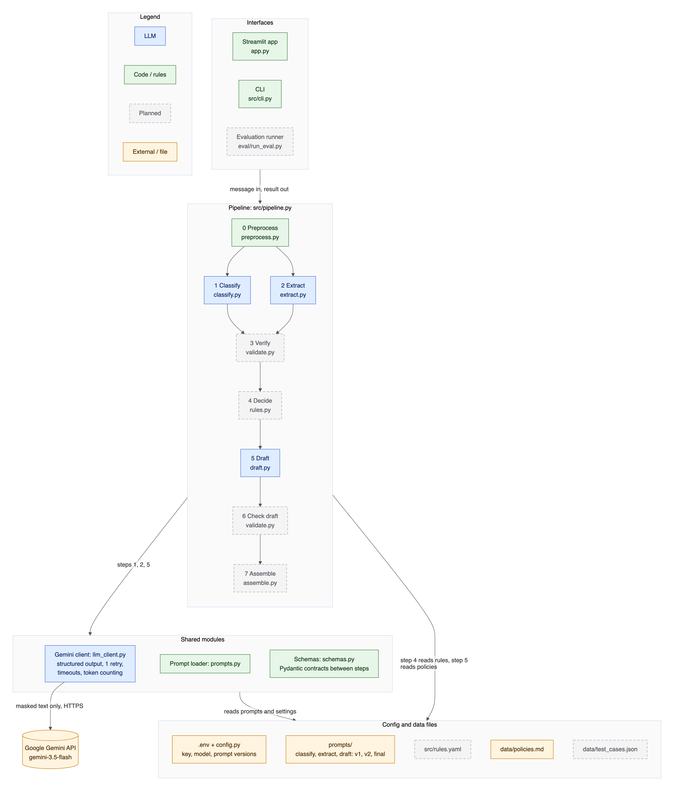

# Technical Specification: Customer Support Intelligence

| Item | Value |
|---|---|
| Version | 0.2 (draft, updated each milestone) |
| Date | 2026-10-26 |
| Build status | Milestone 2 of 8: preprocessing, the three LLM steps, CLI and a basic Streamlit app are built. Steps 3, 4, 6, 7 and the evaluation are **planned** and marked as such below. |
| Related | [Architecture & decisions](architecture.md) · [Prompt engineering](prompt_engineering.md) · [Evaluation](evaluation.md) · [README](../README.md) |

## 1. Purpose and scope

Turn **one raw customer support message** into a structured triage result for a support agent:

| Output field | Meaning |
|---|---|
| Customer Intent | Primary intent (+ secondary intents) from a fixed taxonomy |
| Urgency | Low / Medium / High / Critical |
| Key Information | Product, issue, questions asked, requested outcome, order IDs, amounts, dates, deadline |
| Recommended Action | Next step for the support team |
| Escalation | Yes / No |
| Draft Response | Reply the agent can edit and send |
| Reasoning / Evidence | Quotes, signals and rules behind each decision |

**Out of scope:** sending replies, connecting to order/CRM systems, multi-message conversations, deciding refunds.
The system *recommends*; a human agent decides.

**Hard constraint:** no single giant prompt. The work is split into a chain of small steps; an LLM is used only where
language understanding is needed, and code/rules everywhere else.

## 2. Technology stack

| Layer | Choice | Why |
|---|---|---|
| Language | Python 3.11+ (developed on 3.14) | Team familiarity; standard for AI tooling. |
| LLM | Google Gemini via the official `google-genai` SDK (≥ 2.33); model from `GEMINI_MODEL`, default `gemini-3.5-flash` | Structured JSON output against a schema; fast, low-cost Flash tier. |
| Schemas / validation | Pydantic v2 | One definition validates LLM output *and* generates the JSON schema sent to Gemini. |
| Rules *(planned)* | YAML file (`src/rules.yaml`) + PyYAML | Business rules readable and editable by non-engineers. |
| UI | Streamlit | Fast demo UI; polish is not a priority. |
| Config | `.env` via `python-dotenv` | Keeps the API key out of code and git. |
| Tests | pytest; Gemini replaced by fakes | Run offline, no quota or cost. |
| Docs build | Headless Chrome + Mermaid (`scripts/build_docs.py`) | Diagrams → SVG/PNG, Markdown → PDF, no extra tooling. |

## 3. Architecture

Components and their build status (diagram: Figure 1, next page).

| Component | File | Type | Status |
|---|---|---|---|
| Streamlit app | `app.py` | UI | Built (basic) |
| CLI | `src/cli.py` | UI | Built |
| Orchestrator | `src/pipeline.py` | Code | Built (steps 0, 1, 2, 5) |
| 0 Preprocess | `src/preprocess.py` | Code | Built |
| 1 Classify | `src/classify.py` + `prompts/classify_v1.md` | LLM | Built (V1 prompt) |
| 2 Extract | `src/extract.py` + `prompts/extract_v1.md` | LLM | Built (V1 prompt) |
| 3 Verify | `src/validate.py` | Code | Planned (M4) |
| 4 Decide | `src/rules.py` + `src/rules.yaml` | Rules | Planned (M3) |
| 5 Draft | `src/draft.py` + `prompts/draft_v1.md` + `data/policies.md` | LLM | Built (V1 prompt) |
| 6 Check draft | `src/validate.py` | Code | Planned (M4) |
| 7 Assemble | `src/assemble.py` | Code | Planned (M4) |
| Gemini client | `src/llm_client.py` | Code | Built |
| Prompt loader | `src/prompts.py` | Code | Built |
| Schemas | `src/schemas.py` | Code | Built |
| Evaluation | `eval/run_eval.py`, `data/test_cases.json`, `notebooks/evaluation.ipynb` | Code | Planned (M5) |



*Figure 1: Components. Source: [`diagrams/architecture.mmd`](diagrams/architecture.mmd); also as [SVG](diagrams/architecture.svg).*

## 4. Data flow

How one message moves through the steps, and what data each step hands to the next (diagram: Figure 2).

### 4.1 What leaves the machine
Only the three blue steps send data to Google, and only **masked** text: card numbers, emails and phone numbers are
replaced by placeholders (`[CARD_1]`, `[EMAIL_1]`, `[PHONE_1]`) before any LLM call. The placeholder → value map
(`pii_map`) stays in process memory, is excluded from serialization (`Field(exclude=True)`), and is used only to restore
the customer's email/phone in the final draft. Card numbers are never restored.


*Figure 2: Data flow for one message. Source: [`diagrams/data_flow.mmd`](diagrams/data_flow.mmd); also as [SVG](diagrams/data_flow.svg).*

### 4.2 Step-by-step data contracts

| Step | Input | Output (Pydantic model) |
|---|---|---|
| 0 Preprocess | raw `str` | `PreprocessResult`: `normalized_text`, `masked_text`, `identifiers` (order IDs, amounts, dates, emails, phones, card flag), `flags`, `should_skip_llm` |
| 1 Classify | `masked_text` | `ClassificationResult`: `primary_intent`, `secondary_intents`, `intent_evidence` (quotes), `sentiment`, `frustration`, `is_sarcastic`, `language`, `is_mixed_language`, `confidence`, `reasoning` |
| 2 Extract | `masked_text` | `ExtractionResult`: `product`, `issue_description`, `questions[]`, `requested_outcome`, `prior_contact`, `deadline` (each `{value, quote}`), `signals[]` (`{type, quote}`) |
| 3 Verify *(planned)* | outputs of 0–2 | verified copies + list of failed quotes |
| 4 Decide *(planned)* | verified signals, intent, frustration, identifiers, flags | `Decision`: `urgency`, `escalation`, `recommended_action`, `needs_human_review`, `fired_rules[]`, `review_reasons[]` |
| 5 Draft | facts block (built in code) + `data/policies.md` + `masked_text` | `DraftResult`: `response`, `is_clarifying_question`, `addressed_questions[]` |
| 6 Check draft *(planned)* | `DraftResult` + identifiers + questions | pass / fail with reasons |
| 7 Assemble *(planned)* | all of the above | `SupportResult` (the 7 output fields + `needs_human_review`, `review_reasons`) |
| every step | | `StepTrace`: `name`, `kind`, `prompt_version`, `latency_ms`, `input_tokens`, `output_tokens`, `attempts`, `error`, `output` |

### 4.3 Fixed vocabularies

| Enum | Values |
|---|---|
| `Intent` | refund, billing, technical_issue, delivery, account_access, product_question, complaint, cancellation, feedback, spam_off_topic, unclear |
| `Frustration` | none, low, medium, high |
| `Urgency` | Low, Medium, High, Critical |
| `SignalType` | legal_threat, safety_issue, manager_request, repeat_contact, churn_threat, public_exposure_threat, security_concern |

## 5. Processing pipeline

### 5.1 Step 0: Preprocess (code)
1. **Normalize:** Unicode NFKC (full-width digits → ASCII), remove zero-width characters, collapse spaces, keep at most one blank line. Truncate at 5,000 characters (flag `truncated_long_input`).
2. **Mask PII**, in this order:
   - *Cards:* 13–19 digits (spaces/dashes allowed) **and** a valid Luhn checksum → `[CARD_n]`. Long numbers that fail Luhn are kept (likely order/tracking IDs).
   - *Emails* → `[EMAIL_n]`.
   - *Phones:* three explicit patterns (international `+cc …`, US `(xxx) xxx-xxxx`, Indian 10-digit mobile starting 6–9) → `[PHONE_n]`.
   - The same value always gets the same placeholder.
3. **Extract identifiers** from the *masked* text (so phone digits are never read as an order ID):
   - *Order IDs:* keyword form (`order/invoice/ticket/tracking/AWB/… [no/#/id] [is] X`), `#12345`, and `ABC-12345`. Must contain a digit; fragments of a longer ID are dropped.
   - *Amounts:* currency prefix (`$ € £ ₹ Rs INR USD …`) or suffix (`rupees, dollars, euros, USD …`), Indian grouping `1,00,000`, `k` suffix. Parsed to `{raw, value, currency}`.
   - *Dates:* ISO, `dd/mm/yyyy`, `5th March 2024`, `March 5, 2024`, and relative forms (`yesterday`, `last week`, `3 days ago`, weekdays). Overlapping matches removed.
4. **Gate:** empty → `empty_input`; no letters and no identifiers, < 30 % letters, or ≤ 2 distinct characters → `garbage_input`. Both set `should_skip_llm`. Letters include Unicode marks so Devanagari isn't "garbage". < 4 words → `very_short_message` (still processed).
5. **Flags:** `card_number_masked`; `possible_prompt_injection` (regex: *ignore/disregard … instructions*, *system prompt*, *you are now*, *developer mode*, fake `</customer_message>` tags). Injection is flagged, not blocked.

### 5.2 Steps 1 and 2: Classify and Extract (LLM, in parallel)
Both read only `masked_text`, so they run concurrently in a 2-thread pool. Wall-clock time ≈ the slower of the two.
The message is wrapped in `<customer_message>` tags, and the system prompt says to treat it as data.
Extract does **not** ask for order IDs, amounts or dates (regex already has them exactly).

### 5.3 Step 3: Verify (code), *planned (M4)*
Pydantic validation is already done in the client (§6). Step 3 adds: every `quote` must be a substring of `masked_text`
after whitespace/quote-character normalization; failed quotes are dropped and reported (hallucination metric);
regex identifiers are merged into Key Information.

### 5.4 Step 4: Decide (rules), *planned (M3)*
Deterministic rules in `src/rules.yaml` map signals + intent + frustration + amounts + flags to urgency, escalation,
action and a human-review flag, recording every rule that fired. The LLM provides signals; it never decides.
Unmapped combinations default to "route to human triage". (Rule table to be added here when built.)

### 5.5 Step 5: Draft (LLM)
Input is a **facts block built in code** (intent, product, issue, customer questions, requested outcome, order IDs,
amounts, dates, notes from flags, and, once Step 4 exists, escalation + next step) plus `data/policies.md` (mock
policies, ₹ / IST) and the masked message. The prompt forbids inventing IDs, amounts, dates, timelines, policies or promises
and requires addressing every question. Afterwards `[EMAIL_n]`/`[PHONE_n]` are restored and `[CARD_n]` becomes
"[card number removed]".

### 5.6 Steps 6 and 7: Check draft and Assemble (code), *planned (M4)*
Step 6 fails the draft if it contains an order ID, amount or date not present in the input, or skips an extracted question.
A failure (or any failed LLM step) produces a safe fallback with `needs_human_review = true`. Step 7 builds `SupportResult`
with Reasoning / Evidence lines (quotes, signals, fired rules, flags).

## 6. LLM integration

One wrapper, `GeminiClient.generate(system, user, schema)`, used by every LLM step:

| Parameter | Value |
|---|---|
| Call | `client.models.generate_content(model, contents, config)` |
| `model` | `GEMINI_MODEL` (default `gemini-3.5-flash`, pinned for reproducible evaluation) |
| `config.system_instruction` | prompt file's `=== SYSTEM ===` section |
| `config.response_mime_type` / `response_json_schema` | `application/json` / `Schema.model_json_schema()` |
| `config.thinking_config` | `thinking_level = GEMINI_THINKING_LEVEL` (default `low`) |
| `config.temperature` | `LLM_TEMPERATURE`, default unset = model default (Google's recommendation for Gemini 3) |
| HTTP | timeout `LLM_TIMEOUT_S` (60 s); SDK auto-retry **disabled** (`HttpRetryOptions(attempts=1)`) |

**Retry and error policy**

| Situation | Behaviour |
|---|---|
| Output fails Pydantic validation / invalid JSON | Retry **once**, multi-turn: the model's own output + the exact validation error + "Return the corrected JSON only". |
| 500 / 502 / 503 / 504 | Wait 2 s, retry once (doesn't count against the JSON retry). |
| 429 quota / rate limit | **No retry**; clear error (free tier ≈ 20 requests/model/day). |
| 401 / 403 / bad key, 404 model, network | Clear error message. |
| Any failure | Returned in `LLMResponse.error` (never raised); the pipeline continues and (M4) falls back to human review. |

Token accounting: `input_tokens = prompt_token_count`; `output_tokens = candidates_token_count + thoughts_token_count`
(thinking tokens are billed as output).

**Prompts** live in `prompts/<step>_<version>.md` with `=== SYSTEM ===` / `=== USER ===` sections and `{{placeholders}}`
filled in a single regex pass (customer text containing `{{…}}` is never expanded). Version per step is chosen by
`PROMPT_CLASSIFY` / `PROMPT_EXTRACT` / `PROMPT_DRAFT`.

## 7. Interfaces

### 7.1 CLI
```
python -m src.cli "message"          # every step's output, timing, tokens, then the draft
python -m src.cli --file msg.txt
echo "message" | python -m src.cli
python -m src.cli --json "message"   # full PipelineResult as JSON
```

### 7.2 Streamlit app
`streamlit run app.py` → http://localhost:8501. Example picker (normal, legal threat, sarcasm, injection, card number,
vague, Hinglish, garbage), Analyze button, metrics (end-to-end time, tokens, flags), draft reply, and one expandable
panel per step with its JSON output.

### 7.3 Python
`run_pipeline(message: str, client: LLMClient | None = None) -> PipelineResult`. Any object with
`generate(system, user, schema) -> LLMResponse` can be passed as `client` (used by tests).

## 8. Configuration

| Variable | Default | Meaning |
|---|---|---|
| `GEMINI_API_KEY` | (none) | Google AI Studio key (`GOOGLE_API_KEY` also accepted). |
| `GEMINI_MODEL` | `gemini-3.5-flash` | Model for all LLM steps. |
| `GEMINI_THINKING_LEVEL` | `low` | `minimal` / `low` / `medium` / `high`; empty = model default. |
| `LLM_TEMPERATURE` | unset | Empty = model default. |
| `LLM_TIMEOUT_S` | `60` | Per-request HTTP timeout. |
| `PROMPT_CLASSIFY` / `PROMPT_EXTRACT` / `PROMPT_DRAFT` | `v1` | Prompt version per step. |

Constants in `src/config.py`: `MAX_INPUT_CHARS = 5000`, `SHORT_MESSAGE_WORDS = 4`.

## 9. Security and privacy

- API key only from env / `.env`; `.env` is git-ignored; `.env.example` has no secrets.
- PII masked before any LLM call (§4.1); `pii_map` excluded from serialization, logs and eval files; card numbers never echoed.
- Prompt injection, three layers: (1) message wrapped in tags and declared as data in every prompt; (2) regex flag routes to review;
  (3) **structural**: refunds, escalation and actions are decided by rules (M3), so no LLM output can trigger them.
- Prompt placeholders filled in one pass, so customer text can't inject other prompt sections.
- Input capped at 5,000 characters.

## 10. Testing

`pytest` runs **55 tests**, all offline:

| File | Covers |
|---|---|
| `tests/test_preprocess.py` (43) | normalization, empty/garbage/Hindi, Luhn, card/email/phone masking, stable placeholders, order IDs (6 formats), amounts (6 formats incl. ₹ lakh grouping), dates (6 formats), phone-vs-order-ID, injection flags and a false-positive check, end-to-end preprocess, `pii_map` not serialized |
| `tests/test_llm_steps.py` (12) | prompt files load, placeholder filling (missing and injected placeholders), client: first-try success, token counting incl. thinking, retry-with-error on invalid output, give-up after 2, no retry on 429, one retry on 503; pipeline: step order, LLM never sees PII, email restored in draft, garbage skips LLM |

Rules, verification and draft checks get their own tests when built (M3–M4).

## 11. Evaluation method *(planned, M5)*

≥ 25 hand-written messages in `data/test_cases.json`, labels written **before** the first run, covering normal, multi-intent,
angry, refund + escalation, legal/safety, short/vague, sarcasm, non-English/mixed, spam, prompt injection, no actionable request.

| Metric | Definition |
|---|---|
| Intent accuracy | predicted primary intent == label |
| Urgency accuracy | exact, and within one level |
| Escalation precision / recall | recall prioritised (missed escalations matter most) |
| Extraction field accuracy | per field, against labelled key fields |
| Valid-JSON rate | first-attempt and after-retry |
| Hallucination rate | evidence quotes not found in the input; draft facts not in the input |
| Consistency | 3 runs per case; agreement on intent, urgency, escalation |
| Latency, token cost | per message, from `StepTrace` |

Counts are reported alongside percentages (with 25 cases, one error = 4 points).

## 12. Performance and cost (measured so far)

One end-to-end smoke run (2026-10-26, `gemini-3.5-flash`, thinking `low`). **A single example, not a benchmark:**

| Step | Latency | Tokens in / out |
|---|---|---|
| 1 Classify | 2.5 s | 203 / 125 |
| 2 Extract | 2.7 s | 292 / 224 |
| 5 Draft | 2.5 s | 850 / 166 |
| **End to end** | **5.3 s** (1 and 2 overlap) | **1,345 / 515** |

**Quota constraint:** the current free-tier key allows ≈ 20 requests per model per day; one message uses 3. The full
evaluation (≈ 225+ requests per round) needs a paid key or a response cache spread over several days. *Open decision.*

## 13. Known limitations

- A 10-digit order number starting 6–9 written *without* a keyword ("order", "#") is masked as a phone number.
- ~10 % of random 16-digit IDs pass the Luhn check and are masked as cards.
- Injection regex is English-only and easy to rephrase around; the structural defence (rules decide) is the real protection.
- V1 prompt issues already observed (see [prompt_engineering.md](prompt_engineering.md)): Extract filled `product` with an order ID,
  a requested-outcome quote that doesn't support its value, and the draft applied the return-refund policy to a never-delivered order.
- Until Steps 3, 4, 6 and 7 exist, there is no urgency/escalation, no hallucination check and no fallback reply.

## 14. Regenerating this document

```
pip install markdown
python scripts/build_docs.py     # diagrams/*.mmd -> .svg + .png, this file -> pdf/technical_specification.pdf
```
Needs Google Chrome and internet access (Mermaid loads from a CDN).
